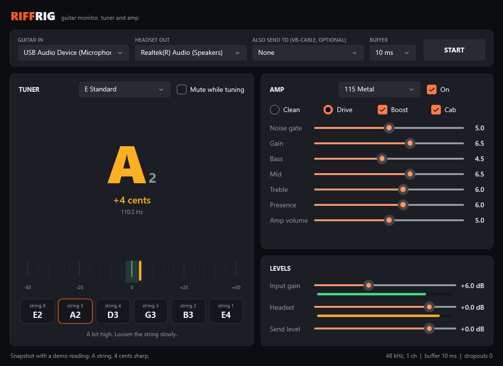

# RiffRig

A small Windows app for playing electric guitar through your PC. Plug in a USB guitar cable or audio interface, pick your headset, and you get:

- **Live monitoring** so you hear the guitar in your headphones
- **A tuner** for 6-string guitar with standard and drop tunings, plus chromatic mode
- **A simple amp** with clean and high-gain channels, boost, noise gate, tone stack and cab sim
- **An optional second output** so you can send the sound to VB-Cable for Discord, OBS or a recorder



## Quick start

1. Plug the guitar cable into the guitar and a USB port.
2. Run `RiffRig.exe`.
3. **GUITAR IN**: your cable. It usually shows up as "USB Audio Device".
4. **HEADSET OUT**: your headphones.
5. Press **START** and play. Raise **Input gain** until the green input meter moves well when you strum.

If you turned on *Listen to this device* for the cable in Windows sound settings, turn it off. Otherwise you will hear the guitar twice.

## Tuner

Pick a tuning at the top of the tuner. The six boxes show each string, low to high. Play one open string and let it ring:

- **Green**: in tune (within 3 cents)
- **Yellow or orange**: off. The text tells you to tighten or loosen the string.

Tunings: E Standard, Eb Standard, D Standard, Drop D, Drop C, C Standard, Chromatic. Tick **Mute while tuning** to silence the headset while you tune.

## Amp presets

| Preset | What it is |
|---|---|
| Clean | No distortion, light warmth |
| Crunch | Classic rock grit |
| 115 Metal | Tight high-gain rhythm tone. Switches the tuner to D Standard |
| Djent Tight | Extra tight and bright, for Drop C |
| Dry (no amp) | The raw guitar signal |

Every knob runs 0 to 10. **Noise gate** at 0 is off. Mids are your friend for metal: scooping them makes the guitar disappear.

## Sending to Discord or OBS

Install [VB-Audio Virtual Cable](https://vb-audio.com/Cable/), set **ALSO SEND TO** to `CABLE Input`, and pick `CABLE Output` as the microphone in the other app. **Send level** sets how loud it is there.

## Troubleshooting

- **Nothing on the input meter**: turn the guitar's volume knob up, check the cable, then raise Input gain.
- **Crackles or dropouts**: raise **BUFFER** to 20 or 40 ms.
- **Feels delayed**: Bluetooth headsets add a lot of delay. Wired headphones feel much better. A lower BUFFER helps a little.
- **Sounds thin or fizzy**: lower Gain, raise Mid, keep Cab on.

## Build from source

Needs the .NET 10 SDK.

```
cd src
dotnet build -c Release
```

Single-file exe:

```
dotnet publish src -c Release -r win-x64 --self-contained false -p:PublishSingleFile=true -o dist
```

Self test (tuner accuracy on synthetic strings, amp levels, CPU use; add `live` for a short run on the real devices):

```
RiffRig.exe --selftest result.txt [live]
```

## License

MIT
